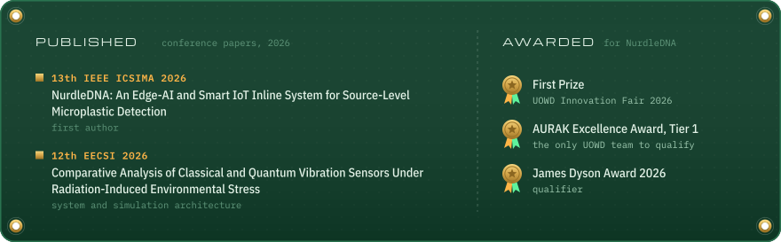

  <picture>
    <source media="(max-width: 600px)" srcset="https://raw.githubusercontent.com/Faaz17/Faaz17/main/assets/hero-mobile.svg">
    
  </picture>

  

  <picture>
    <source media="(max-width: 600px)" srcset="https://raw.githubusercontent.com/Faaz17/Faaz17/main/assets/career-mobile.svg">
    
  </picture>

  <picture>
    <source media="(max-width: 600px)" srcset="https://raw.githubusercontent.com/Faaz17/Faaz17/main/assets/record-mobile.svg">
    
  </picture>

  <picture>
    <source media="(max-width: 600px)" srcset="https://raw.githubusercontent.com/Faaz17/Faaz17/main/assets/activity-mobile.svg">
    
  </picture>

  <picture>
    <source media="(max-width: 600px)" srcset="https://raw.githubusercontent.com/Faaz17/Faaz17/main/assets/bench-mobile.svg">
    
  </picture>

  <a href="https://github.com/Faaz17/nurdle-dna"><picture>
    <source media="(max-width: 600px)" srcset="https://raw.githubusercontent.com/Faaz17/Faaz17/main/assets/project-nurdle-dna-mobile.svg">
    
  </picture></a>

  <a href="https://github.com/Faaz17/ResQ"><picture>
    <source media="(max-width: 600px)" srcset="https://raw.githubusercontent.com/Faaz17/Faaz17/main/assets/project-resq-mobile.svg">
    
  </picture></a>

  <a href="https://github.com/Faaz17/Breathe"><picture>
    <source media="(max-width: 600px)" srcset="https://raw.githubusercontent.com/Faaz17/Faaz17/main/assets/project-breathe-mobile.svg">
    
  </picture></a>

  <a href="https://github.com/Faaz17/Agents-and-Skills"><picture>
    <source media="(max-width: 600px)" srcset="https://raw.githubusercontent.com/Faaz17/Faaz17/main/assets/project-agents-and-skills-mobile.svg">
    
  </picture></a>

  <a href="https://github.com/Faaz17/Spacecraft-Nervous-System-Simulation"><picture>
    <source media="(max-width: 600px)" srcset="https://raw.githubusercontent.com/Faaz17/Faaz17/main/assets/project-spacecraft-nervous-system-simulation-mobile.svg">
    
  </picture></a>

<a href="generator/">A small Python script</a> in this repo draws every card on this page and redraws them each morning from GitHub data.

