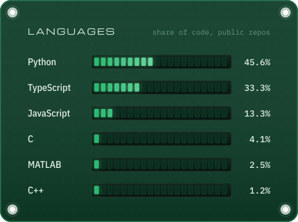
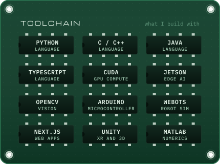

  

  

Hi, I'm Faaz. I study Computer Engineering at the University of Wollongong in Dubai, and most of my projects put code on hardware or into a robot simulator: computer vision on a Jetson, Arduino control loops, robots in Webots.

For 2026/27 I'm President of the Engineers Australia Student Society at UOWD, and I build the registration, quiz and live-scoring apps our events run on.

Ask me about Jetson and CUDA, embedded state machines, Webots, or setting up Claude Code agents for a real project.

  

  
  

  
  

  
  

<a href="generator/">A small Python script</a> in this repo draws every card on this page and redraws them each morning from GitHub data.

